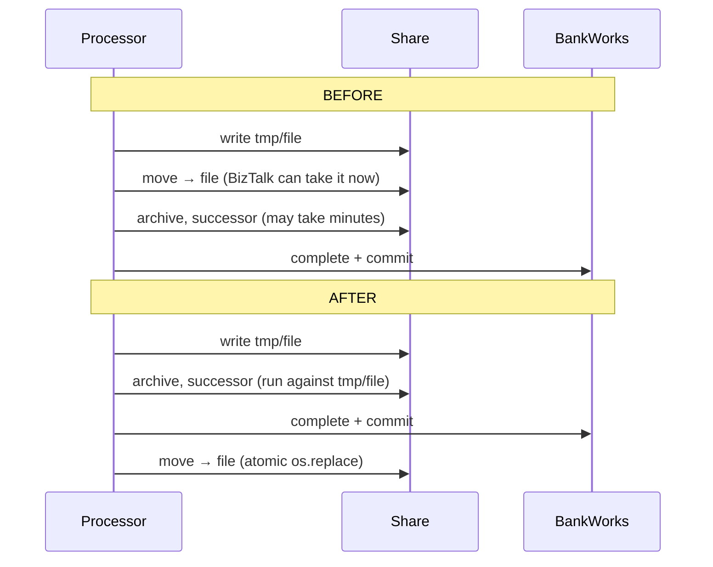
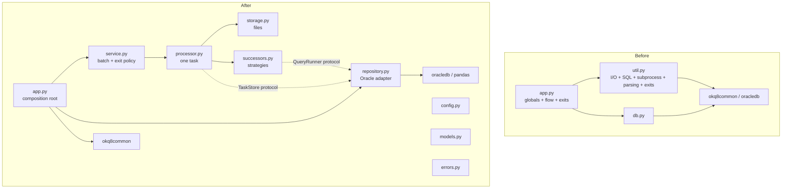

# outward: review and refactoring notes

This document covers what I found, what I changed and why, which design
principles guided the changes, and how the result is tested. Each section maps
to one or more commits on the `refactor` branch, so the reasoning can be
followed step by step with `git log -p`.

| Commit | Step |
|---|---|
| 1 | Declare dependencies, add test tooling |
| 2 | Typed settings, domain models, exception hierarchy |
| 3 | Storage layer: LOB streaming fixes, atomic publish |
| 4 | Successors as strategies behind a registry |
| 5 | `TaskRepository` over the BankWorks procedures |
| 6 | Processor, service and composition root; publish after commit |

---

## 1. What the service does

A batch job in a container. Each run it:

1. checks that the network share is mounted (marker files),
2. tells BankWorks it is starting, so tasks it left half-done are released,
3. fetches pending outward tasks,
4. for each task, calls the task's own stored procedure, writes the returned
   LOB to the share for BizTalk, optionally writes an archive copy and runs a
   *successor* (a shell script, or a manifest of queries exported as files),
5. marks the task complete in the database.

## 2. Problems found

### 2.1 Structure

| # | Problem | Consequence |
|---|---|---|
| S1 | `bw3`, `config` and `logger` are module globals created under `if __name__ == "__main__"` | `app.py` cannot be imported, for example by tests; functions have hidden inputs |
| S2 | `sys.exit()` called from deep inside helpers (`util.move_file`, `write_successor_data`) | Helpers can't be reused or tested; exit policy is spread across files |
| S3 | `util.py` mixes filesystem I/O, SQL execution, subprocess handling and parsing | Low cohesion; everything depends on everything |
| S4 | pandas `Series` and 11-element positional tuples are the data contract between layers | Column names and tuple positions are implicit; easy to break silently |
| S5 | Config values are cast (`int(...)`, `.split(",")`) at the point of use | Bad config is discovered mid-batch, possibly after files were written |
| S6 | Successor types are an `if/elif` chain over strings | Every new type edits existing logic |
| S7 | `requirements.txt` is empty and there are no tests | No reproducible build, no safety net |
| S8 | `os.EX_*` constants | Exist only on Unix; the code can't even be imported to test on Windows |

### 2.2 Bugs

Each bug was reproduced against the original code before fixing it. Each one
now has a regression test.

| # | Bug | Original behaviour | Fix | Test |
|---|---|---|---|---|
| B1 | **File published before the DB commit.** `move_file` runs before the archive write, the successor and `complete_task` | A crash or DB error in that window means BizTalk already has the file, the task is reset, and it is delivered **twice** | Publish only after `complete()` commits (see §3.1) | `test_file_is_published_only_after_completion_is_committed`, `test_completion_failure_leaves_nothing_for_biztalk` |
| B2 | Empty successor manifest | `UnboundLocalError` (`completion_status` never assigned) | Defaults to `002`, 0 files | `test_empty_manifest_is_ok_with_zero_files` |
| B3 | Blank or short manifest row | `IndexError` | Blank lines skipped; short rows give a clear `SuccessorError`; whole manifest validated before any query | `test_blank_lines_…`, `test_malformed_manifest_fails_before_any_query_runs` |
| B4 | Empty status column in a manifest row | `"".zfill(3)` gives status `000` | Defaults to `002` | `test_empty_status_column_defaults_to_ok_instead_of_000` |
| B5 | `ARCHIVE_DATA` (or `OUTWARD_DATA`) is NULL | `AttributeError` on `None.getchunksize()` | NULL is written as an empty file, with a warning | `test_archive_with_null_data_writes_empty_file` |
| B6 | CLOB returned instead of BLOB | `lob.read()` returns `str`; writing to a `"wb"` file raises `TypeError` (the docstring claims CLOBs are supported) | Encode with configurable `clob_encoding` (default cp1252, matching the manifest encoding) | `test_write_clob_is_encoded` |
| B7 | `get_task` returns an empty DataFrame | `IndexError` on `.iloc[0]` | `DatabaseError` naming the process id | `test_fetch_payload_with_no_output_raises` |
| B8 | `hbin` query returns no rows | `TypeError` on `None[0]` | `SuccessorError` | `test_binary_successor_with_no_rows_raises` |
| B9 | Shell successor prints non-UTF-8 output (e.g. Swedish characters in cp1252) | `decode('utf-8')` raises inside the `try`, so a **successful** script is reported as failed (`003`) | `errors="replace"` | `test_shell_non_utf8_output_does_not_turn_success_into_failure` |
| B10 | Shell successor hangs | Blocks the whole queue forever | Optional `successor_timeout` | `test_shell_timeout_is_a_failure` |
| B11 | `mount_checks` env var unset | `AttributeError: None.split` | `ConfigError` at start-up | `test_unset_mount_checks_is_a_config_error` |
| B12 | LOB read returns no data before `size()` is reached | Infinite loop | `StorageError` | `test_lob_that_stops_returning_data_raises_instead_of_looping_forever` |
| B13 | Bare `except:` around successor SQL | The ORA- error is swallowed; the log only says "Error processing file" | Catch `oracledb.Error`, keep the message and chain it | `test_run_query_wraps_database_errors` |
| B14 | `NaN` in optional columns | NaN is truthy, so it is treated as a real archive file name | Normalise None, NaN and blank to `None` | `test_fetch_payload_maps_row_and_normalises_nulls` |
| B15 | Successor CSV/BIN outputs written in place | BizTalk can pick up a half-written file | Same stage-then-rename as the main file | `test_failed_write_does_not_publish_partial_file` |

### 2.3 Security

- **PL/SQL injection via procedure name.** `INTEGRATION_NAME` comes from a
  database row and is used as a procedure name. `oracledb`'s `callproc`
  interpolates the name into `begin <name>(…); end;`, so a crafted value could
  run arbitrary PL/SQL. All procedure names are now validated as Oracle
  identifiers before use (`qualified_procedure`). Test:
  `test_fetch_payload_rejects_injected_integration_name`.
- **Database content acts as code by design.** Successor manifests contain raw
  SQL, and `hshl` runs a shell script delivered by the database. I left this as
  is because it is the product's contract. But it means write access to those
  tables equals code execution in the container. That's worth raising with the
  team (least-privilege DB user for successor queries, read-only role, or an
  allow-list of export views).

## 3. Design decisions

### 3.1 Publish after commit (the most important change)

The original docstring states the intent: *"not picked by BizTalk until we are
certain that the process has completed in the database"*. The code did not do
that: the file was moved into place first.



**Trade-off.** No ordering of a file system and a database is atomic without
2-phase commit. The choice is which failure mode to accept:

| | Crash window | Result |
|---|---|---|
| Before | from the move until the commit, which includes successors (seconds to minutes) | Duplicate delivery to a downstream bank partner, silently |
| After | between commit and `os.replace` (microseconds) | File left in `tmp/`, task marked complete; error is logged with the path for manual recovery |

A duplicate payment or report file is the worse and less visible failure, and
the window shrinks by orders of magnitude. If even that window is unacceptable,
the next step is a start-up sweep that publishes leftover `tmp/` files whose
task is already complete. That needs a DB query I don't have, so I didn't build
it (YAGNI until confirmed).

**Consequence to confirm with the team:** successors now receive the
*staged* path (`dir/tmp/file`) instead of `dir/file`. Manifests are unaffected.
An `hshl` script that uses `$(dirname "$0")` would see the `tmp/` folder.

### 3.2 Layering and dependency direction



- **app.py** builds objects and calls `run_batch`. It is the only importer
  of `okq8common`.
- **service.py** handles the batch loop and *the single* error → exit-code mapping.
- **processor.py** contains the business flow for one task, with no Oracle or
  pandas.
- **repository.py** is the only module that knows procedure names,
  parameter shapes, column names, DataFrames and commit semantics.
- **storage.py / successors.py** hold focused I/O helpers.
- **config.py / models.py / errors.py** contain typed data with no
  behaviour beyond validation.

### 3.3 Errors raise, the entry point exits

Helpers raise typed exceptions (`ConfigError`, `MountCheckError`,
`DatabaseError`, `StorageError`, `SuccessorError`). Each carries its exit
code. `service.exit_code()` is the only place that logs and converts them.
**Exit codes are unchanged** for operations: 72 for mount failures, 74 for
I/O/DB failures. The new codes are 78 (bad config) and 70 (unexpected bug).

### 3.4 Behaviour I deliberately kept

Refactoring should not change behaviour unless that change is a fix. I kept:

- **Fail-fast batch.** The first failing task stops the run. The comment about
  Trapets says some integrations are serial, so later tasks must not overtake a
  failed one; `container_startup` + `retry_limit` already retry it.
  *Alternative:* per-task isolation (log and continue) gives better throughput
  for independent integrations. It could be made per-integration if the
  database exposed that property.
- **Successor status wins** over the main file's, and in a manifest **the last
  row's status wins**. That looks questionable ("worst status wins" may be the
  intent), but it is a business rule, so it's a question for the team, not
  something to change unilaterally.
- **Shell success = exit 0 *and* empty stderr.** Strict (warnings fail the
  task), but it is the existing contract.
- **Completion parameters**, including `file_count` sent twice, which is
  presumably expected vs. written. They are now named fields of `TaskResult`
  and the tuple is built in one place.
- **CSV output encoding** is still the platform default (UTF-8 in a Linux
  container). It should probably be explicit, but changing output bytes for
  downstream consumers needs confirmation.

### 3.5 Things I chose not to do

- No retry/backoff framework, async, or parallelism. It is a small batch job,
  and ordering matters for serial integrations.
- No plugin discovery for successors. A dict registry is enough.
- No rewrite of `okq8common` usage. It is internal and shared; the
  `BankworksClient` protocol documents exactly what this service uses from it.
- I did not remove the unused `heartbeat`, `db_timeout` and `oracle_client`
  config. They are probably read inside `okq8common`.

## 4. Design patterns and principles

| Pattern / principle | Where | Why |
|---|---|---|
| **Composition root + dependency injection** (constructor injection) | `app.main` builds everything; classes receive collaborators | Removes globals (S1); every class is testable with fakes |
| **Repository** | `TaskRepository` | One place for persistence details; callers deal in domain objects |
| **Adapter / anti-corruption layer** | Repository maps DataFrame rows to `PendingTask` / `TaskPayload`; `BankworksClient` protocol | Keeps pandas, column names and the odd `curBw3`/`dbConn` API from leaking (S4) |
| **Ports via `typing.Protocol`** (hexagonal-lite) | `TaskStore`, `TaskQueue`, `QueryRunner`, `Successor`, `Lob` | Dependency Inversion: the processor depends on an interface it owns, not on Oracle |
| **Strategy + registry** | `ShellSuccessor`, `CsvSuccessor`, `BinarySuccessor`, `build_successors` | Open/Closed: a new type is a new class plus one dict entry (S6) |
| **Template Method** | `ManifestSuccessor.run` defines the loop; subclasses implement `write` | No duplication between CSV and BIN |
| **Value Objects** | Frozen dataclasses in `models.py`, `Settings` | Immutable, named, comparable in tests |
| **Write-then-rename (atomic publish)** | `staging_path`, `publish`, `staged_file` | Readers never see partial files (B1, B15) |
| **Exception hierarchy at the boundary** | `errors.py`, `service.exit_code` | One exit policy (S2) |
| **Single Responsibility** | One reason to change per module (§3.2) | Splits `util.py` (S3) |
| **Fail fast / parse, don't validate** | `Settings.from_dict`, manifest parsed before any query | Errors surface before side effects (S5, B3) |
| **DRY** | `Procedures.qualified`, `TaskProcessor._write` | The `package + "." + name` concatenation appeared four times |
| **YAGNI / KISS** | §3.5 | Complexity only where a real problem justifies it |
| **Least astonishment** | Exit codes and log messages kept; fixes are behaviour-preserving except §3.1 | Ops dashboards and alerts keep working |

## 5. Testing

### 5.1 What exists (80 tests, ~98% line coverage of `outward/`, runs in ~2 s)

```
pip install -r requirements-dev.txt      # okq8common is only needed to run app.py
pytest --cov=outward
```

- **Unit tests** for each module, using hand-written fakes (`tests/fakes.py`)
  rather than `mock.patch`. Fakes model behaviour (1-based LOB offsets,
  `fetchmany` batching, commit/rollback log), so tests assert outcomes
  instead of call details.
- **Regression tests** for every bug in §2.2, named after the bug.
- **Ordering tests.** The fake store records whether the final file was
  visible at the moment `complete()` was called. This is how B1 is pinned.
- **Cross-platform shell tests.** `ShellSuccessor` takes the interpreter as
  a parameter, so tests run Python scripts and work on Windows CI too.
- **End-to-end test** (`test_end_to_end_with_real_components_and_fake_database`):
  real repository, processor, CSV successor and storage, wired as in `app.py`,
  with only the database faked. It checks files on disk and the exact
  completion tuple.
- **Entry point smoke test** (manual, during development): ran `app.py` as a
  process with a stub `okq8common` and verified exit codes 0, 72 and 78.

### 5.2 What I would add next

1. **Integration tests against real Oracle.** Use `gvenzl/oracle-free` via
   Testcontainers in CI, with a minimal fake `bw_okq8_biztalk_integration`
   package. This verifies real LOB/CLOB reads, `CURSOR` OUT params, commit
   behaviour and `callproc` name handling, which fakes can't prove.
2. **Contract test for `okq8common.Bankworks`.** Check that it still satisfies
   `BankworksClient` (method names, `callproc` return value on failure), so a
   library upgrade can't silently break the adapter.
3. **Failure-injection test of the crash window.** Kill the process at each
   step (after staging, after successor, after commit) and assert
   "no duplicate, no loss" across a restart.
4. **Characterisation in staging.** Run old and new versions on the same
   queue snapshot and diff output directories and completion rows byte for
   byte, before switching production.
5. **Static checks in CI:** `ruff`, `mypy --strict` (the protocols make this
   meaningful), and `pytest --cov --cov-fail-under=90`.

## 6. Open questions for the team

1. Do any `hshl` scripts depend on their own location (`$0`)? (§3.1)
2. Should a manifest's overall status be the *worst* row status rather than the last?
3. Should one failed task stop the batch for *all* integrations, or only serial ones?
4. What encoding do downstream consumers expect for CSV successor output?
5. Is a stuck `tmp/` file (crash between commit and rename) acceptable as a
   manual-recovery case, or do we want an automatic start-up sweep?
6. What are the two trailing empty parameters of `update_biztalk_log_ext`, and
   is column 2 of the manifest really unused?
